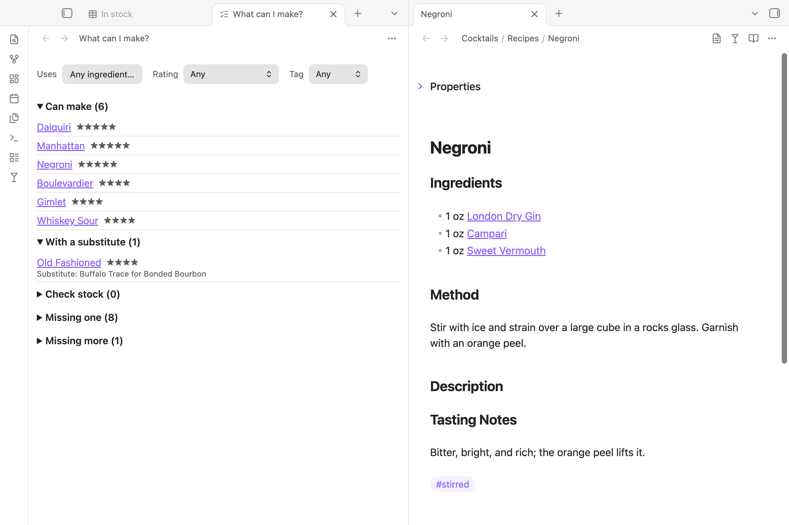
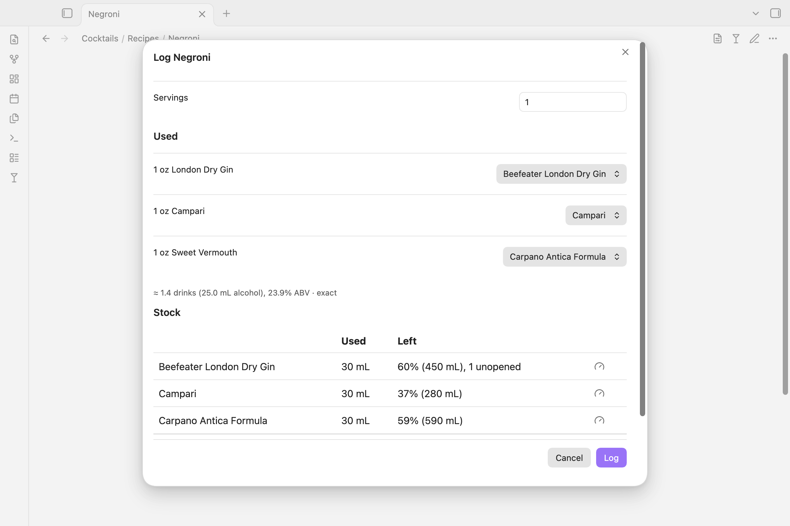
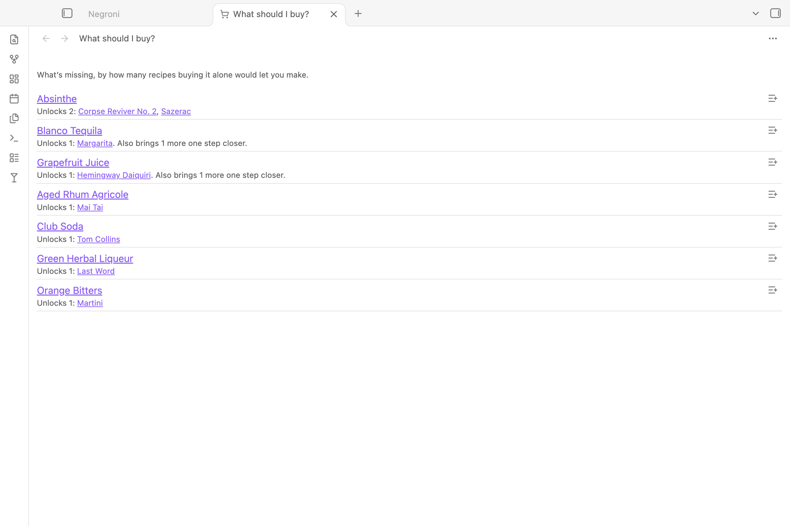
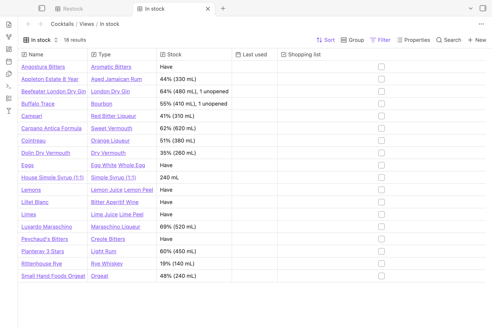
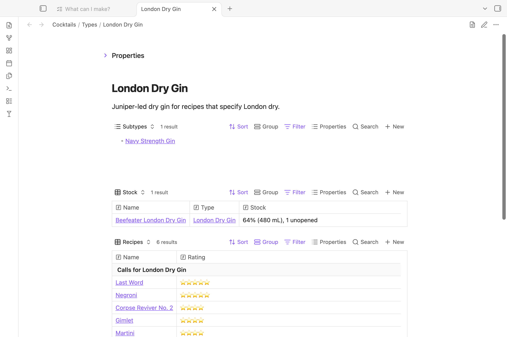

# Cocktail Cabinet

Keep your cocktail recipes and home bar in Obsidian: what you have, what you can make with it, and what to buy next. Everything is ordinary Markdown notes and core Bases, so your collection stays readable and editable without the plugin.

> **Beta.** The plugin is in daily use, but note properties may still change between releases, and it has had less testing on phones than on desktop. Bug reports are very welcome in [Issues](https://github.com/jrduncans/obsidian-cocktail-cabinet/issues), and questions and ideas in [Discussions](https://github.com/jrduncans/obsidian-cocktail-cabinet/discussions); see [contributing](CONTRIBUTING.md).

## What it does

- **A starter cabinet.** Setup creates an ingredient hierarchy of about 170 types (Rye Whiskey, Aged Jamaican Rum, Lime Juice, Demerara Syrup…) grouped into optional families and categories, live views, a guide, and a small worked example.
- **Recipes that link to ingredients.** Add a recipe by hand, from pasted text, or from a recipe page's address. Each ingredient line links to a type ("rum"), a narrower type, or a particular bottle, and broad links stay broad.
- **Stock you can keep up with.** Track bottles in mL or just as Have, Low, or Out. Fresh fruit, homemade syrups, and juices are stock too. **Edit stock**, **Record purchases**, and a **Restock** view keep it current.
- **Log a drink.** **Log this cocktail** previews what each bottle loses, subtracts it, and adds "Made a Daiquiri." to your daily note. Undo, one-offs, and riffs are covered.
- **What can I make?** Every recipe sorted by how close you are: can make, with a substitute, missing one, and so on. **What should I buy?** ranks missing ingredients by how many recipes each would unlock.
- **Shopping list and alcohol estimates.** Flag anything for the shopping list. Each recipe gets an estimate of its alcohol and ABV, so you can find lower-alcohol drinks.
- **Agent-friendly.** An **Agent Reference** note and `obsidian` command-line handlers let AI agents check availability and add recipes.

## Screenshots











## Install

Cocktail Cabinet needs Obsidian 1.12.2 or later, on desktop or mobile, with the core **Bases** plugin enabled (**Settings → Core plugins**).

- **Community plugins** (once listed): **Settings → Community plugins → Browse**, search for Cocktail Cabinet, then **Install** and **Enable**.
- **BRAT** (beta releases): install the [BRAT](https://github.com/TfTHacker/obsidian42-brat) plugin, run **BRAT: Add a beta plugin for testing**, and enter `jrduncans/obsidian-cocktail-cabinet`.
- **Manually**: download `main.js`, `manifest.json`, and `styles.css` from the [latest release](https://github.com/jrduncans/obsidian-cocktail-cabinet/releases) into `<vault>/.obsidian/plugins/cocktail-cabinet/`, then enable **Cocktail Cabinet** in **Settings → Community plugins**.

## Get started

1. Select the glass ribbon icon or run **Cocktail Cabinet: Open cabinet**.
2. Choose a folder (`Cocktails` by default) and select **Preview** to see what setup will create, then **Create cabinet**. Setup never overwrites existing notes.
3. Open the **Cocktail Cabinet** note. It links to the views and to a guide in `<folder>/Guide/`: Getting Started, Recipes, Stock, Making Drinks, Shopping, Hierarchy and Substitutes, and Views and Customizing.
4. Add a few bottles (**Add stock**) and a recipe (**Add recipe**), then try **What can I make?** and **Log this cocktail**.

Most commands also appear in a note's file menu (right-click, or **More options** on mobile) and as buttons in the note header where they apply.

## Your notes stay yours

- Recipes, bottles, stock, and ingredient types are Markdown notes with `cc-`-prefixed properties and ordinary wiki links. With the plugin disabled they still read, link, and render in Bases.
- The plugin keeps a few notes current with each release: the Cocktail Cabinet and Shopping list notes, the guide, and the views in `<folder>/Views/`. Edit a managed note and the plugin asks before replacing it (**Review cabinet updates**). To change a view, copy it into `<folder>/Custom views/`, which the plugin never touches.
- Starter ingredient notes are yours to edit. A later release updates a field only if you haven't changed it, and otherwise asks.

## Learn more

- [Features](docs/features.md): every command, view, and setting in detail.
- [Note properties](docs/note-properties.md): what each property means and stores.
- [Starter hierarchy](docs/starter-hierarchy.md): the full ingredient list.
- [Availability](docs/availability.md): how **What can I make?** decides, and the agent command-line output.
- [Glossary](GLOSSARY.md) and the [design records](docs/README.md).

## Current limits

- Note properties may change before 1.0. Release notes will say when a change affects existing notes.
- There is no importer for an existing cocktail collection in another format; set up a fresh cabinet folder and add recipes with **Add recipe** or **Convert note to recipe**.
- Recipe pages are read from their recipe data or visible text, and Difford's Guide pages from their ingredient table and steps. Pages behind a sign-in or built by scripts can't be read; paste the text instead.
- Batches and measured juice yields are not modeled.
- After you move or rename the cabinet folder, restart Obsidian once its link updating has finished (a minute or two). The plugin holds off changing notes until then. See [moving the cabinet](docs/features.md#setup).
- Testing has mostly been on desktop. Everything is available on mobile; logging and moving the cabinet folder have been tried on a phone, other workflows less so.

## Storage and privacy

All runtime operations stay in your vault, with one exception: when you give **Add recipe** a web address and select **Read recipe**, **Read page**, or **Read recipe page…**, the plugin fetches that one page to read its recipe. It sends nothing but that request, fetches nothing else (no images, linked pages, or searches), and never fetches on its own. It collects no telemetry. The plugin lists file names across the vault, to find cabinet notes, catch name clashes, and find your daily note; it reads notes' contents only in the cabinet folder, your daily notes, a note you run one of its commands on, and, when you rename a cabinet note, the notes that link to it. External reference links on ingredient pages open only when selected.

## Development

Use Node.js 20+ and npm:

```sh
npm install
npm run dev
```

Checks:

```sh
npm test
npm run build
npm run lint
```

After changing starter ingredients, run `npm run catalog:docs` to regenerate the hierarchy table and catalog history. `npm test` checks that both are current.

For development, install into a test vault from any branch, uncommitted changes included:

```sh
npm run install:dev -- --vault '/path/to/test vault'
```

It works like `install:vault` below without the clean-`main` check. Avoid symlinking the plugin folder to this repository instead: iCloud doesn't sync a symlink's target, so the plugin never reaches mobile. Generated bundles are ignored by Git.

To install in a real vault, or update it, run from a clean `main`:

```sh
npm run install:vault -- --vault '/path/to/vault'
```

It builds, copies `main.js`, `manifest.json`, and `styles.css` to `<vault>/.obsidian/plugins/cocktail-cabinet/`, keeps the vault's `data.json` settings, and asks Obsidian to reload the plugin. It refuses a branch other than `main`, uncommitted changes, and a symlinked plugin folder. Bump the version with `npm version patch` before an install you want to tell apart.

The development override pins Obsidian's transitive Moment dependency to `2.31.0`. The plugin bundle keeps `obsidian` external and uses its bundled `moment` export for Daily notes; it does not bundle a separate Moment library.

## License

[0BSD](LICENSE).
